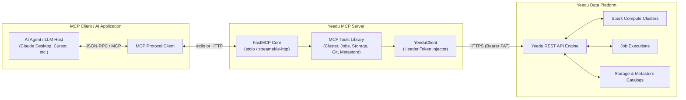

# Yeedu MCP Server

Official [Model Context Protocol (MCP)](https://modelcontextprotocol.io) server for the [Yeedu Data Platform](https://yeedu.io).

The **Yeedu MCP Server** empowers AI agents (such as Claude Desktop, Cursor, and custom MCP clients) to securely inspect, manage, and automate data infrastructure across Yeedu workspace resources—including Spark clusters, job execution, object storage, metastore catalogs, git repositories, and billing usage.

---

## Architecture




### Core Architecture Components

| Component | Responsibility |
|---|---|
| **FastMCP Core** | Standardized MCP server lifecycle supporting both `stdio` and `streamable-http` transport modes. |
| **YeeduClient** | Centralized, authenticated HTTP client maintaining connection pools, SSL validation, and payload serialization. |
| **Tool Handlers** | Modular Python tool modules enforcing schema validation, uniform table output formatting, and pagination. |
| **Security Vault** | Environment-based credential management ensuring tokens never leak into prompt context. |

---

## Key Features

- **Spark Cluster Lifecycle**: Provision, start, stop, scale workers, and monitor compute clusters with lifecycle status history, node-level events, logs, and error diagnostics.
- **Spark Job Execution**: Manage and execute Custom Code (PySpark/Raw Scala/Spark SQL), JAR, Thrift SQL, and Function job definitions; inspect live STDOUT/STDERR logs and job execution analytics.
- **Workspace & File Management**: Browse workspace file trees, upload, download, copy, move, rename, and inspect workspace permissions.
- **Integrated Git Workflows**: Clone HTTPS repositories, manage/switch branches, view file diffs, stage changes, commit/push to remote repositories, and sync/discard local modifications.
- **Metastore & Catalog Discovery**: Explore Hive, Unity, and Glue metastores; browse schemas, tables, functions, and volumes; extract column schemas and table DDL statements.
- **Object Storage Management**: Inspect Object Storage Managers (OSM), list bucket contents, download file content, and delete storage objects across cloud providers.
- **Billing & Cost Analytics**: Generate detailed billing reports (up to 90 days) analyzing total runtime minutes, YCU (Yeedu Compute Unit) consumption, and per-cluster cost breakdowns.


---

## Security Architecture & Token Handling

Security is built into the server's design through **Token Isolation**:

1. **Argless Credentials**: Personal Access Tokens (PAT) are never accepted as tool input parameters from the LLM host.
2. **Environment Injection**: The API token (`YEEDU_API_KEY`) is loaded strictly from environment variables at startup and maintained within `YeeduClient`.
3. **Header Authentication**: Outbound requests automatically attach `Authorization: Bearer <token>` at the transport layer.
4. **Context Protection**: Credentials are omitted from tool schemas, preventing credentials from appearing in LLM system prompts, tool call arguments, or conversation history logs.

---

## Quick Start

The server is published on PyPI and runs with [`uvx`](https://docs.astral.sh/uv/guides/tools/), so there is nothing to clone or install by hand. Every client below runs the same command:

```bash
uvx yeedu-mcp-server@latest
```

`uvx` downloads the package into a cached, isolated environment (and a matching Python if needed) on first launch. `@latest` makes it pick up new releases on each start; pin a version instead (`yeedu-mcp-server==0.1.0`) if you want fixed behaviour.

### Prerequisites

1. **Install `uv`** (once per machine; it provides `uvx`):

   ```bash
   # macOS / Linux
   curl -LsSf https://astral.sh/uv/install.sh | sh
   # Windows
   powershell -ExecutionPolicy ByPass -c "irm https://astral.sh/uv/install.ps1 | iex"
   ```

2. **Create a Personal Access Token** in the Yeedu UI (profile → tokens).

3. **Find your API base URL.** This is the Yeedu **API** address, usually the UI host on port `8080` (e.g. `https://demo.yeedu.io:8080`). Do not use the UI address itself or add `/api/v1`. To check, `curl -k https://<host>:8080/api/v1/user` should return a JSON message, not an HTML page.

Python 3.12+ is required, but `uvx` fetches it automatically if it is missing.

---

## Configuration

Environment variables configure the server via `pydantic-settings`:

| Variable | Required | Default | Description |
|---|---|---|---|
| `YEEDU_API_KEY` | ✅ | — | Yeedu Personal Access Token (PAT) |
| `YEEDU_API_BASE_URL` | ✅ | — | Base URL of your Yeedu instance (e.g. `https://yeedu.example.com:8080`) |
| `YEEDU_MCP_TRANSPORT` | optional | `stdio` | Transport mode: `stdio` or `streamable-http` |
| `YEEDU_MCP_SERVER_URL` | optional | `http://127.0.0.1:8000/mcp` | Server URL when running in `streamable-http` mode |
| `VERIFY_SSL` | optional | `false` | Enable strict TLS certificate verification |
| `YEEDU_SSL_CERT_PATH` | optional | — | Custom CA bundle file path for self-signed certificates |
| `LOG_LEVEL` | optional | `INFO` | Output logging verbosity: `DEBUG`, `INFO`, `WARNING`, `ERROR` |
| `LOG_DIR` | optional | `~/.yeedu-mcp/logs` | Directory for the rotating log file (`yeedu-mcp-server.log`) |
| `LOG_MAX_BYTES` | optional | `5242880` (5 MB) | Size at which the log file rotates |
| `LOG_BACKUP_COUNT` | optional | `3` | Rotated files kept; total disk use is capped at about 20 MB |

> **Configuration Precedence**: Environment variables set in the host environment or passed via client configuration (`mcpServers.env`) override local `.env` files.

---

## Client Integration Setup

In every example, replace `your-personal-access-token` and `https://your-yeedu-instance:8080` with your own values. Restart (or reload MCP in) the client after editing its config.

### Claude Code

```bash
claude mcp add --scope user yeedu \
  -e YEEDU_API_BASE_URL=https://your-yeedu-instance:8080 \
  -e YEEDU_API_KEY=your-personal-access-token \
  -- uvx yeedu-mcp-server@latest
```

`--scope user` makes it available in every project. Use `--scope project` to write a shareable `.mcp.json` into the repo instead, and keep the token out of it by referencing an environment variable (`"YEEDU_API_KEY": "${YEEDU_API_KEY}"`). Check with `claude mcp list` or `/mcp`.

### Claude Desktop

Edit `claude_desktop_config.json`:

- **macOS**: `~/Library/Application Support/Claude/claude_desktop_config.json`
- **Windows**: `%APPDATA%\Claude\claude_desktop_config.json`
- **Linux**: `~/.config/Claude/claude_desktop_config.json`

```json
{
  "mcpServers": {
    "yeedu": {
      "command": "uvx",
      "args": ["yeedu-mcp-server@latest"],
      "env": {
        "YEEDU_API_KEY": "your-personal-access-token",
        "YEEDU_API_BASE_URL": "https://your-yeedu-instance:8080"
      }
    }
  }
}
```

### OpenAI Codex

```bash
codex mcp add yeedu \
  --env YEEDU_API_BASE_URL=https://your-yeedu-instance:8080 \
  --env YEEDU_API_KEY=your-personal-access-token \
  -- uvx yeedu-mcp-server@latest
```

Or add it to `~/.codex/config.toml` directly:

```toml
[mcp_servers.yeedu]
command = "uvx"
args = ["yeedu-mcp-server@latest"]

[mcp_servers.yeedu.env]
YEEDU_API_BASE_URL = "https://your-yeedu-instance:8080"
YEEDU_API_KEY = "your-personal-access-token"
```

### Google Antigravity (IDE and `agy` CLI)

Open **Manage MCP Servers → View raw config** (or edit `~/.gemini/config/mcp_config.json`; older builds use `~/.gemini/antigravity/mcp_config.json`) and add:

```json
{
  "mcpServers": {
    "yeedu": {
      "command": "uvx",
      "args": ["yeedu-mcp-server@latest"],
      "env": {
        "YEEDU_API_KEY": "your-personal-access-token",
        "YEEDU_API_BASE_URL": "https://your-yeedu-instance:8080"
      }
    }
  }
}
```

### Gemini CLI

Add the same `mcpServers` block as Antigravity to `~/.gemini/settings.json` (or `.gemini/settings.json` in a project).

### OpenCode

Add to `opencode.json` (project root) or `~/.config/opencode/opencode.json`:

```json
{
  "$schema": "https://opencode.ai/config.json",
  "mcp": {
    "yeedu": {
      "type": "local",
      "command": ["uvx", "yeedu-mcp-server@latest"],
      "enabled": true,
      "environment": {
        "YEEDU_API_KEY": "your-personal-access-token",
        "YEEDU_API_BASE_URL": "https://your-yeedu-instance:8080"
      }
    }
  }
}
```

### Cursor / Windsurf

Use the same `mcpServers` block as Claude Desktop in:

- **Cursor**: `~/.cursor/mcp.json` (global) or `.cursor/mcp.json` (project)
- **Windsurf**: `~/.codeium/windsurf/mcp_config.json`

### VS Code (GitHub Copilot)

Add to `.vscode/mcp.json` (or run **MCP: Add Server** from the command palette):

```json
{
  "servers": {
    "yeedu": {
      "type": "stdio",
      "command": "uvx",
      "args": ["yeedu-mcp-server@latest"],
      "env": {
        "YEEDU_API_KEY": "your-personal-access-token",
        "YEEDU_API_BASE_URL": "https://your-yeedu-instance:8080"
      }
    }
  }
}
```

### Any other MCP client

Configure a `stdio` server with command `uvx`, args `["yeedu-mcp-server@latest"]`, and the two environment variables above.

### Troubleshooting

- **`uvx: command not found` / server fails to start in a desktop app.** GUI apps often don't inherit your shell `PATH`. Use the absolute path from `which uvx` (macOS/Linux) or `where uvx` (Windows) as the `command`.
- **Tools return HTML or 404s.** `YEEDU_API_BASE_URL` points at the UI, not the API. Use the API host and port (typically `:8080`).
- **401 / "Auth Token not found".** The token is missing or expired; create a new PAT.
- **Logs** are written to `~/.yeedu-mcp/logs/yeedu-mcp-server.log` (rotating, capped at about 20 MB).

### Running from source

For development, point the client at a local checkout instead of `uvx`:

```bash
uv run --directory /path/to/yeedu-mcp-server yeedu-mcp-server
```

### Remote HTTP mode

To run one shared server over HTTP (`streamable-http`) instead of `stdio`:

```bash
YEEDU_API_KEY=your-token YEEDU_API_BASE_URL=https://your-yeedu-instance:8080 \
  uvx yeedu-mcp-server@latest --transport streamable-http
```

The server listens on `http://127.0.0.1:8000/mcp` (see `YEEDU_MCP_SERVER_URL`). Every request uses the single `YEEDU_API_KEY` it was started with, so run one instance per user.

---

## Available Tools

The Yeedu MCP server exposes 40+ production tools categorized by platform domain:

### 1. Identity & Access
| Tool | Description |
|---|---|
| `get_user_info` | Retrieves current authenticated user profile, tenant memberships, and assigned roles. |
| `list_tenants` | Lists available tenants accessible to the authenticated user. |
| `get_user_roles` | Gets roles assigned to a user within a specific tenant context. |
| `get_roles` | Lists all platform system roles and descriptions. |
| `get_workspace_permissions` | Checks user access levels for a given workspace. |
| `list_workspace_permissions` | Lists all available permission levels across workspaces. |

### 2. Cluster Management
| Tool | Description |
|---|---|
| `list_clusters` | Searches cluster instances filtered by name, status, config, or state. |
| `get_cluster_details` | Retrieves full configuration specifications (vCPU, memory, cloud env, Spark version). |
| `create_cluster` | Creates a new compute cluster (YEEDU, STANDALONE, or CLUSTER type). |
| `update_cluster` | Updates cluster settings such as name, idle timeout, worker counts, or labels. |
| `cluster_action` | Controls lifecycle actions: `start`, `stop`, `destroy`, `disable`, `enable`, `stop_all_jobs`. |
| `get_cluster_events` | Gets status-change lifecycle history for a cluster. |
| `get_cluster_node_events` | Retrieves node-level utilization and IP addressing metrics. |
| `get_cluster_logs` | Fetches STDOUT or STDERR logs for specific cluster node status events. |
| `get_cluster_errors` | Retrieves system error details for cluster startup or operational failures. |
| `get_cluster_prerequisites` | Fetches available cloud environments, machine types, and Spark infra versions. |
| `get_cluster_stats` | Displays job status execution breakdown for a cluster. |
| `get_cluster_workspaces` | Lists workspaces attached to a cluster instance. |
| `analyze_cluster_issue` | Generates diagnostic investigation guides for cluster failures. |

### 3. Spark Jobs & Executions
| Tool | Description |
|---|---|
| `list_job_configurations` | Lists job definitions filtered by type, language, status, or workspace. |
| `get_job_configuration` | Retrieves detailed job definition metadata and code/command settings. |
| `create_job` | Creates new Spark job configurations (Custom Code, Thrift SQL, Functions, JAR). |
| `edit_job` | Modifies existing job configurations and Spark resource allocations. |
| `run_job` | Submits a job configuration for execution with optional runtime arguments. |
| `stop_job_run` | Cancels an active or submitted job run. |
| `workspace_job_runs` | Views execution run history across a workspace. |
| `get_job_run_details` | Gets run-level execution status, runtime config, and status transition history. |
| `get_job_run_logs` | Retrieves STDOUT or STDERR log output for job runs. |
| `get_job_errors` | Gets workflow engine system errors for failed job runs. |
| `analyze_job_issue` | Generates diagnostic investigation checklists for failed or degraded jobs. |

### 4. Workspace & Files
| Tool | Description |
|---|---|
| `list_workspaces` | Lists workspace environments with job/notebook aggregate counts. |
| `browse_workspace_files` | Navigates directory file trees inside a workspace. |
| `get_workspace_file` | Downloads raw text contents of workspace files. |
| `upload_workspace_file` | Uploads new files or creates directories in a workspace. |
| `manage_workspace_file` | Manages file operations: `delete`, `rename`, `move`, `copy`. |
| `get_workspace_stats` | Gets aggregated job execution statistics for a workspace. |
| `get_workspace_clusters` | Lists cluster instances attached to a workspace. |
| `export_workspace` | Exports job and notebook configurations to `.yeedu` or `.zip` archives. |

### 5. Git Operations
| Tool | Description |
|---|---|
| `git_clone_repo` | Clones a remote HTTPS Git repository into a workspace folder. |
| `git_branches` | Lists, creates, or switches Git branches in workspace repositories. |
| `git_status` | Inspects workspace repository status (staged, untracked, modified). |
| `git_stage_files` | Stages modified files for upcoming commits. |
| `git_file_diff` | Views diff details for modified repository files. |
| `git_commit_push` | Commits staged changes and pushes to remote Git branches. |
| `git_sync` | Synchronizes repositories via remote `pull` or local change `discard`. |
| `list_git_credentials` | Lists user Git credentials configured for platform repositories. |

### 6. Metastore & Catalogs
| Tool | Description |
|---|---|
| `list_metastore_catalogs` | Lists configured metastores (Hive, Unity, Glue). |
| `browse_catalog` | Browses catalogs, schemas, tables, functions, or volumes. |
| `get_table_details` | Retrieves table column schemas or raw SQL `CREATE TABLE` DDL. |

### 7. Object Storage & Secrets
| Tool | Description |
|---|---|
| `list_storage_managers` | Lists configured Object Storage Managers across AWS, GCP, Azure, or OnPrem. |
| `manage_osm_files` | Lists, downloads, or deletes files in object storage buckets. |
| `get_billing_report` | Generates billing usage reports with per-cluster YCU and cost breakdowns. |
| `list_user_secrets` | Lists personal user secrets. |
| `list_workspace_secrets` | Lists workspace-scoped secrets and environment variables. |

### 8. Platform Metadata Reference
| Tool | Description |
|---|---|
| `get_job_types` | Displays supported internal job type codes. |
| `get_job_languages` | Displays supported programming languages per job type. |
| `get_job_statuses` | Lists all valid job execution status codes. |
| `get_cluster_statuses` | Lists all valid cluster lifecycle status codes. |
| `get_cluster_node_statuses` | Lists all valid node event status codes. |

---

## Local Development & Testing

```bash
# Install project dependencies
uv sync

# Configure development environment
cp .env.example .env
# Edit .env to set YEEDU_API_KEY and YEEDU_API_BASE_URL

# Launch MCP Inspector (Interactive Web GUI for testing tools)
uv run mcp dev src/yeedu_mcp_server/main.py

# Execute Python test compilation check
uv run python -m py_compile src/yeedu_mcp_server/main.py
```

### Self-Signed SSL Certificates

For enterprise on-premise Yeedu deployments with custom/self-signed SSL certificates:

```bash
# Enable certificate validation with custom CA path
VERIFY_SSL=true
YEEDU_SSL_CERT_PATH=/path/to/ca-certificates.crt
```

---