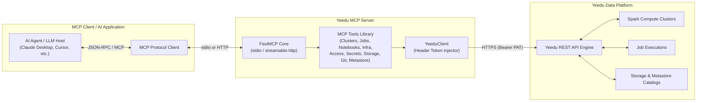

# Yeedu MCP Server

Official [Model Context Protocol (MCP)](https://modelcontextprotocol.io) server for the [Yeedu Data Platform](https://yeedu.io).

The **Yeedu MCP Server** empowers AI agents (such as Claude Desktop, Cursor, and custom MCP clients) to securely inspect, manage, and automate data infrastructure across Yeedu workspace resources—including Spark clusters, job and notebook execution, cloud infrastructure, tenants and access control, secrets, object storage, metastore catalogs, git repositories, and billing usage.

---

## Architecture




### Core Architecture Components

| Component | Responsibility |
|---|---|
| **FastMCP Core** | Standardized MCP server lifecycle supporting both `stdio` and `streamable-http` transport modes. |
| **YeeduClient** | Centralized, authenticated HTTP client maintaining connection pools, SSL validation, and payload serialization. |
| **Tool Handlers** | Modular Python tool modules enforcing schema validation, uniform table output formatting, and pagination. |
| **Security Vault** | Environment-based credential management ensuring tokens never leak into prompt context. |

---

## Key Features

- **Spark Cluster Lifecycle**: Provision, start, stop, scale workers, and monitor compute clusters with lifecycle status history, node-level events, logs, and error diagnostics.
- **Spark Job Execution**: Manage and execute Custom Code (PySpark/Raw Scala/Spark SQL), JAR, Thrift SQL, and Function job definitions; inspect live STDOUT/STDERR logs and job execution analytics.
- **Workspace & File Management**: Browse workspace file trees, upload, download, copy, move, rename, and inspect workspace permissions.
- **Integrated Git Workflows**: Clone HTTPS repositories, manage/switch branches, view file diffs, stage changes, commit/push to remote repositories, and sync/discard local modifications.
- **Metastore & Catalog Discovery**: Explore Hive, Unity, and Glue metastores; browse schemas, tables, functions, and volumes; extract column schemas and table DDL statements.
- **Object Storage Management**: Inspect Object Storage Managers (OSM), list bucket contents, download file content, and delete storage objects across cloud providers.
- **SQL Querying**: Run SQL on a cluster over Thrift and get rows back, with the catalog the query resolved against.
- **Run Diagnostics**: Split a run's wall-clock into execution and queueing time, and name the bottleneck.
- **Usage & Cost Analytics**: Usage reports (up to 90 days) of runtime minutes and YCU (Yeedu Compute Unit) consumption per cluster — YCU measures machine shape, not money — plus `job_cost_report` for estimated cloud spend in currency.
- **Notebooks**: Create, edit, clone, and run notebooks; start and manage kernels, execute ad-hoc code or selected cells, and read run logs.
- **Tenant & Access Administration**: Manage tenants and workspaces, browse the user/group directory, assign platform and tenant roles, and grant or revoke workspace access.
- **Infrastructure Configuration**: Manage cloud environments, credential, network, volume and boot-disk configurations, cluster configurations, and cluster mounts.
- **Secrets & Tokens**: List tenant, workspace and user secrets, git credentials, and API tokens, and rename, re-describe or delete them — without any secret value crossing the tool interface (see below).


---

## Security Architecture & Token Handling

Security is built into the server's design through **Token Isolation**:

1. **Argless Credentials**: Personal Access Tokens (PAT) are never accepted as tool input parameters from the LLM host.
2. **Environment Injection**: The API token (`YEEDU_API_KEY`) is loaded strictly from environment variables at startup and maintained within `YeeduClient`.
3. **Header Authentication**: Outbound requests automatically attach `Authorization: Bearer <token>` at the transport layer.
4. **Context Protection**: Credentials are omitted from tool schemas, preventing credentials from appearing in LLM system prompts, tool call arguments, or conversation history logs.

Two further guardrails cover the administrative tools:

5. **Credential Handoff**: No secret value crosses the tool interface in either direction. The operations that would carry one — `manage_secret` create/rotate, `manage_git_credential` create/rotate, `manage_token` create — do not perform the action. They return the exact CLI command and the UI screen for the user to run that one step themselves, and the agent continues by id afterwards. Everything that does not carry a value (listing, renaming, re-describing, deleting, referencing by id) stays in the server.

6. **Confirmation Gate**: Every destructive operation takes a `confirm` parameter and refuses to act without it. Called without it the tool performs nothing: it reads the record back and returns what would be lost, plus the exact line to retry. The agent is instructed never to set `confirm` on a first call and never to self-confirm — the flag means a human has seen that specific record and said yes.

7. **Blast Radius**: Lifecycle refusals report the surroundings, not just the target — runs in flight, workspaces attached, how long a run has been executing — because stopping a cluster kills every run on it and a cluster is often shared. A cluster name matching more than one cluster is refused rather than guessed.

---

## Quick Start

The server is published on PyPI and runs with [`uvx`](https://docs.astral.sh/uv/guides/tools/), so there is nothing to clone or install by hand. Every client below runs the same command:

```bash
uvx yeedu-mcp-server
```

`uvx` downloads the package into a cached, isolated environment (and a matching Python if needed) on first launch, then reuses that cache. To pick up a new release, run `uvx yeedu-mcp-server@latest` once (or use `@latest` in the config to check on every start); to pin a version, use `yeedu-mcp-server==0.1.0`.

### Prerequisites

1. **Install `uv`** (once per machine; it provides `uvx`):

   ```bash
   # macOS / Linux
   curl -LsSf https://astral.sh/uv/install.sh | sh
   # Windows
   powershell -ExecutionPolicy ByPass -c "irm https://astral.sh/uv/install.ps1 | iex"
   ```

2. **Create a Personal Access Token** in the Yeedu UI (profile → tokens).

3. **Find your API base URL.** This is the Yeedu **API** address, usually the UI host on port `8080` (e.g. `https://demo.yeedu.io:8080`). Do not use the UI address itself or add `/api/v1`. To check, `curl -k https://<host>:8080/api/v1/user` should return a JSON message, not an HTML page.

Python 3.12+ is required, but `uvx` fetches it automatically if it is missing.

---

## Configuration

Environment variables configure the server via `pydantic-settings`:

| Variable | Required | Default | Description |
|---|---|---|---|
| `YEEDU_API_KEY` | ✅ | — | Yeedu Personal Access Token (PAT) |
| `YEEDU_API_BASE_URL` | ✅ | — | Base URL of your Yeedu instance (e.g. `https://yeedu.example.com:8080`) |
| `YEEDU_UI_BASE_URL` | optional | — | Base URL of the web UI, when it differs from the API host. Set it so the credential-handoff tools print a clickable link to the screen the user needs; unset, they name the screen without revealing a host. |
| `YEEDU_API_TIMEOUT` | optional | `60.0` | Request timeout in seconds |
| `YEEDU_MCP_TRANSPORT` | optional | `stdio` | Transport mode: `stdio` or `streamable-http` |
| `YEEDU_MCP_SERVER_URL` | optional | `http://127.0.0.1:8000/mcp` | Server URL when running in `streamable-http` mode |
| `VERIFY_SSL` | optional | `false` | Enable strict TLS certificate verification |
| `YEEDU_SSL_CERT_PATH` | optional | — | Custom CA bundle file path for self-signed certificates |
| `YEEDU_MCP_PRICE_TABLE` | optional | — | JSON file of cloud rates for `job_cost_report`, overriding the built-in on-demand list prices |
| `LOG_LEVEL` | optional | `INFO` | Output logging verbosity: `DEBUG`, `INFO`, `WARNING`, `ERROR` |
| `LOG_FORMAT` | optional | see `logging_setup.py` | `logging` format string for the log file |
| `LOG_DIR` | optional | `~/.yeedu-mcp/logs` | Directory for the rotating log file (`yeedu-mcp-server.log`) |
| `LOG_MAX_BYTES` | optional | `5242880` (5 MB) | Size at which the log file rotates |
| `LOG_BACKUP_COUNT` | optional | `3` | Rotated files kept; total disk use is capped at about 20 MB |
| `YEEDU_POOL_SIZE` | optional | `10` | Connection pool size |
| `YEEDU_POOL_MAX_CONNECTIONS` | optional | `100` | Maximum pooled connections |
| `YEEDU_POOL_MAX_KEEPALIVE` | optional | `50` | Maximum idle keep-alive connections |
| `YEEDU_POOL_MAX_CONCURRENT` | optional | `500` | Maximum concurrent in-flight requests |

> **Configuration Precedence**: Environment variables set in the host environment or passed via client configuration (`mcpServers.env`) override local `.env` files.

---

## Client Integration Setup

In every example, replace `your-personal-access-token` and `https://your-yeedu-instance:8080` with your own values. Restart (or reload MCP in) the client after editing its config.

### Claude Code

```bash
claude mcp add --scope user yeedu \
  -e YEEDU_API_BASE_URL=https://your-yeedu-instance:8080 \
  -e YEEDU_API_KEY=your-personal-access-token \
  -- uvx yeedu-mcp-server
```

`--scope user` makes it available in every project. Use `--scope project` to write a shareable `.mcp.json` into the repo instead, and keep the token out of it by referencing an environment variable (`"YEEDU_API_KEY": "${YEEDU_API_KEY}"`). Check with `claude mcp list` or `/mcp`.

### Claude Desktop

Edit `claude_desktop_config.json`:

- **macOS**: `~/Library/Application Support/Claude/claude_desktop_config.json`
- **Windows**: `%APPDATA%\Claude\claude_desktop_config.json`
- **Linux**: `~/.config/Claude/claude_desktop_config.json`

```json
{
  "mcpServers": {
    "yeedu": {
      "command": "uvx",
      "args": ["yeedu-mcp-server"],
      "env": {
        "YEEDU_API_KEY": "your-personal-access-token",
        "YEEDU_API_BASE_URL": "https://your-yeedu-instance:8080"
      }
    }
  }
}
```

### OpenAI Codex

```bash
codex mcp add yeedu \
  --env YEEDU_API_BASE_URL=https://your-yeedu-instance:8080 \
  --env YEEDU_API_KEY=your-personal-access-token \
  -- uvx yeedu-mcp-server
```

Or add it to `~/.codex/config.toml` directly:

```toml
[mcp_servers.yeedu]
command = "uvx"
args = ["yeedu-mcp-server"]

[mcp_servers.yeedu.env]
YEEDU_API_BASE_URL = "https://your-yeedu-instance:8080"
YEEDU_API_KEY = "your-personal-access-token"
```

### Google Antigravity (IDE and `agy` CLI)

Open **Manage MCP Servers → View raw config** (or edit `~/.gemini/config/mcp_config.json`; older builds use `~/.gemini/antigravity/mcp_config.json`) and add:

```json
{
  "mcpServers": {
    "yeedu": {
      "command": "uvx",
      "args": ["yeedu-mcp-server"],
      "env": {
        "YEEDU_API_KEY": "your-personal-access-token",
        "YEEDU_API_BASE_URL": "https://your-yeedu-instance:8080"
      }
    }
  }
}
```

### Gemini CLI

Add the same `mcpServers` block as Antigravity to `~/.gemini/settings.json` (or `.gemini/settings.json` in a project).

### OpenCode

Add to `opencode.json` (project root) or `~/.config/opencode/opencode.json`:

```json
{
  "$schema": "https://opencode.ai/config.json",
  "mcp": {
    "yeedu": {
      "type": "local",
      "command": ["uvx", "yeedu-mcp-server"],
      "enabled": true,
      "environment": {
        "YEEDU_API_KEY": "your-personal-access-token",
        "YEEDU_API_BASE_URL": "https://your-yeedu-instance:8080"
      }
    }
  }
}
```

### Cursor / Windsurf

Use the same `mcpServers` block as Claude Desktop in:

- **Cursor**: `~/.cursor/mcp.json` (global) or `.cursor/mcp.json` (project)
- **Windsurf**: `~/.codeium/windsurf/mcp_config.json`

### VS Code (GitHub Copilot)

Add to `.vscode/mcp.json` (or run **MCP: Add Server** from the command palette):

```json
{
  "servers": {
    "yeedu": {
      "type": "stdio",
      "command": "uvx",
      "args": ["yeedu-mcp-server"],
      "env": {
        "YEEDU_API_KEY": "your-personal-access-token",
        "YEEDU_API_BASE_URL": "https://your-yeedu-instance:8080"
      }
    }
  }
}
```

### Any other MCP client

Configure a `stdio` server with command `uvx`, args `["yeedu-mcp-server"]`, and the two environment variables above.

### Troubleshooting

- **`uvx: command not found` / server fails to start in a desktop app.** GUI apps often don't inherit your shell `PATH`. Use the absolute path from `which uvx` (macOS/Linux) or `where uvx` (Windows) as the `command`.
- **Tools return HTML or 404s.** `YEEDU_API_BASE_URL` points at the UI, not the API. Use the API host and port (typically `:8080`).
- **401 / "Auth Token not found".** The token is missing or expired; create a new PAT.
- **Logs** are written to `~/.yeedu-mcp/logs/yeedu-mcp-server.log` (rotating, capped at about 20 MB).

### Running from source

For development, point the client at a local checkout instead of `uvx`:

```bash
uv run --directory /path/to/yeedu-mcp-server yeedu-mcp-server
```

### Remote HTTP mode

To run one shared server over HTTP (`streamable-http`) instead of `stdio`:

```bash
YEEDU_API_KEY=your-token YEEDU_API_BASE_URL=https://your-yeedu-instance:8080 \
  uvx yeedu-mcp-server --transport streamable-http
```

The server listens on `http://127.0.0.1:8000/mcp` (see `YEEDU_MCP_SERVER_URL`). Every request uses the single `YEEDU_API_KEY` it was started with, so run one instance per user.

---

## Available Tools

The server exposes **101 tools**. Read operations are plain tools; write operations are grouped into `manage_*` tools that take an `action` parameter, so one tool covers the create / list / get / edit / delete surface of a resource.

Three conventions apply throughout:

- Any `action` that destroys or disables something takes `confirm=True`. Without it the tool performs nothing and returns the record it would have changed.
- No tool accepts or returns a secret value. The operations that would carry one return the CLI command and UI screen for the user to run that step themselves.
- A listing that matches nothing returns zero rows and the filters it applied, not an error. A 404 meaning the thing you filtered *by* does not exist is still an error.

### 1. Identity, Directory & Access
| Tool | Description |
|---|---|
| `get_user_info` | Current authenticated user's profile, tenant memberships, and assigned roles. |
| `get_user_roles` | Roles assigned to a user, optionally scoped to one tenant. |
| `get_roles` | Platform system roles and their descriptions. |
| `browse_directory` | Reads the tenant's user and group directory: `list`, `search`, `get`, `match`. |
| `manage_role_assignment` | Tenant role assignment for a user or group: `list`, `get`, `by_role`, `assign`, `remove`. Inherited roles are reported with the group they come from. |
| `manage_workspace_access` | Who can use a workspace: `list`, `search`, `grant`, `edit`, `revoke`, `members`, `memberships`. |
| `get_workspace_permissions` | The calling user's access level on a given workspace. |
| `list_workspace_permissions` | The permission levels a workspace grant can use. |

### 2. Tenants & Workspaces
| Tool | Description |
|---|---|
| `list_tenants` | Tenants accessible to the authenticated user. |
| `manage_tenant` | Tenant administration (Platform Admin): `list`, `search`, `get`, `user`, `create`, `edit`, `delete`. |
| `list_workspaces` | Workspaces with job and notebook counts. |
| `manage_workspace` | `create`, `edit` (rename / re-describe), `enable`, `disable`. Workspaces are disabled rather than deleted. |
| `get_workspace_stats` | Aggregated job-run status counts for a workspace. |
| `get_workspace_clusters` | Cluster instances attached to a workspace. |
| `export_workspace` | Exports job and notebook definitions to a `.yeedu` file, or a `.zip` when notebooks are present. |
| `import_workspace` | Imports jobs and notebooks from an export file into a workspace. |

### 3. Cluster Management
| Tool | Description |
|---|---|
| `list_clusters` | Searches cluster instances by name, status, config, or enabled state. |
| `get_cluster_details` | Full configuration: machine specs, cloud environment, network, Spark version, autoscaling, audit fields. |
| `create_cluster` | Creates a cluster instance from a cluster configuration and cloud environment. |
| `update_cluster` | Changes name, idle timeout, worker counts, or labels. |
| `cluster_action` | Lifecycle: `start`, `stop`, `destroy`, `disable`, `enable`, `stop_all_jobs`. The destructive actions are gated and first report what they would take down. |
| `get_cluster_events` | Status-change history, with the status IDs the log and error tools need. |
| `get_cluster_node_events` | Node-level utilization and addressing events. |
| `get_cluster_logs` | STDOUT or STDERR for a cluster node status event. |
| `get_cluster_errors` | System error detail for startup or operational failures. |
| `get_cluster_stats` | Job execution counts for a cluster, by status. |
| `get_cluster_workspaces` | Workspaces attached to a cluster instance. |
| `get_cluster_prerequisites` | Cloud environments, machine types, and Spark infra versions available for a new cluster. |
| `analyze_cluster_issue` | Diagnostic investigation guide for a cluster failure. |

### 4. Infrastructure Configuration
These build the stack a cluster needs, bottom up: a credential configuration, then a network configuration and boot disk image, then a cloud environment, then a cluster configuration.

| Tool | Description |
|---|---|
| `list_compute_lookups` | Platform-seeded reference data the create calls need: `cloud_providers`, `availability_zones`, `machine_types`, `disk_machine_types`, `credential_types`, `linux_distros`, `spark_infra_versions`, `spark_compute_types`. |
| `manage_credential_config` | Cloud credential configurations, the base every other resource references by id. |
| `manage_network_config` | Network configurations. A subnet and availability zone are fields here; there is no separate subnet resource. |
| `manage_boot_disk_image` | Boot disk image configurations — the OS image nodes boot from. |
| `manage_volume_config` | Standalone volume configurations (disk layout templates). |
| `manage_cloud_env` | Cloud environments, binding a credential config, network config and boot disk image. Also `list_onprem_nodes`. |
| `manage_cluster_config` | Cluster configurations — machine shape and disk layout. |
| `manage_cluster_mount` | Object storage (S3, ADLS, GCS, S3a) mounted into a cluster's filesystem, referencing a credential configuration by id. |
| `manage_cluster_workspace_access` | `associate` / `dissociate` a cluster with a workspace, which is what makes it selectable there. |

### 5. Spark Jobs & Executions
| Tool | Description |
|---|---|
| `list_job_configurations` | Job definitions filtered by type, language, status, or workspace. |
| `get_job_configuration` | Job definition metadata and code/command settings. |
| `create_job` | Creates a job definition (Custom Code, Thrift SQL, Functions, JAR). |
| `edit_job` | Changes a job definition and its Spark resource allocation. |
| `run_job` | Submits a job definition for execution, with optional runtime arguments. |
| `stop_job_run` | Cancels an active or submitted run. |
| `workspace_job_runs` | Run history across a workspace. |
| `get_job_run_details` | Run status, runtime configuration, and status transitions. |
| `get_job_run_logs` | STDOUT or STDERR for a run. |
| `get_job_errors` | Workflow engine errors for a failed run. |
| `diagnose_run` | Splits a run's wall-clock into execution and waiting time and names the bottleneck. |
| `job_cost_report` | Estimates what a run, or a job's recent runs, cost the cloud account, in currency. |
| `analyze_job_issue` | Diagnostic checklist for a failed or degraded job. |

### 6. Notebooks
| Tool | Description |
|---|---|
| `list_notebooks` | Notebook definitions in a workspace. |
| `get_notebook` | Notebook definition and cell contents. |
| `create_notebook` | Creates a notebook definition against a cluster. |
| `edit_notebook` | Changes a notebook definition. |
| `clone_notebook` | Copies a notebook definition. |
| `set_notebook_state` | Enables or disables a notebook. |
| `start_notebook` | Starts a notebook run. |
| `start_notebook_kernel` | Starts the kernel for a run. |
| `notebook_kernel_action` | Kernel lifecycle: interrupt, restart, shut down. |
| `get_notebook_kernel_status` | Current kernel state. |
| `execute_notebook_code` | Runs ad-hoc code in a live kernel and returns the output. |
| `run_notebook_cells` | Runs the notebook's own cells and optionally saves the outputs back. |
| `list_notebook_runs` | Run history for notebooks. |
| `get_notebook_run` | Status and configuration of one notebook run. |
| `get_notebook_run_logs` | STDOUT or STDERR for a notebook run. |
| `stop_notebook_run` | Stops an active notebook run. |

### 7. Workspace Files & Git
| Tool | Description |
|---|---|
| `browse_workspace_files` | Navigates a workspace's directory tree. |
| `get_workspace_file` | Reads a workspace file's text contents. |
| `upload_workspace_file` | Uploads a file or creates a directory. |
| `manage_workspace_file` | `delete`, `rename`, `move`, `copy`. |
| `git_clone_repo` | Clones an HTTPS repository into a workspace folder. |
| `git_branches` | Lists, creates, or switches branches. |
| `git_status` | Staged, modified, and untracked files. |
| `git_stage_files` | Stages modified files. |
| `git_file_diff` | Diff for a modified file. |
| `git_commit_push` | Commits staged changes and pushes. |
| `git_sync` | `pull` from remote or `discard` local changes. |

### 8. Metastore & Catalogs
| Tool | Description |
|---|---|
| `list_metastore_catalogs` | Configured metastores (Hive, Unity, Glue). |
| `manage_metastore_catalog` | `create`, `edit`, `delete` a metastore catalog configuration; the fields that apply depend on `catalog_type`. |
| `manage_catalog_secret_link` | Links a catalog to the secrets used to reach it, at `user`, `workspace` or `tenant` scope. |
| `browse_catalog` | Browses catalogs, schemas, tables, functions, or volumes. |
| `get_table_details` | Column schema or raw `CREATE TABLE` DDL. |
| `run_sql` | Executes SQL on a cluster over Thrift and returns rows, naming the catalog the query resolved against. |
| `find_sql_clusters` | Finds the running clusters that can serve a SQL query, so a query does not have to start by guessing a cluster. |
| `find_metastore_for_object` | Finds which metastore catalog holds a named table or schema. |

### 9. Object Storage, Secrets & Billing
| Tool | Description |
|---|---|
| `list_storage_managers` | Object Storage Managers across AWS, GCP, Azure, and OnPrem. |
| `manage_osm_files` | `list`, `download`, `delete` files in object storage. |
| `list_tenant_secrets` | Secrets at tenant scope, usable by every workspace in the tenant. |
| `list_workspace_secrets` | Secrets and environment variables scoped to a workspace. |
| `list_user_secrets` | The calling user's personal secrets. |
| `manage_secret` | Renames, re-describes or deletes a secret. `create` and `rotate` carry a value, so they hand off to the CLI or UI. |
| `list_git_credentials` | The user's Git credentials, never their tokens. |
| `manage_git_credential` | `get`, `edit` (username), `delete`. `create` and `rotate` carry the token, so they hand off. |
| `manage_token` | `list` and `delete` API tokens. `create` hands off, because the new token value would otherwise pass through the model's context. |
| `get_billing_report` | Usage report for a date range (max 90 days): minutes, YCU consumption, and a per-cluster breakdown. |

### 10. Platform Metadata Reference
| Tool | Description |
|---|---|
| `get_job_types` | Supported job type codes. |
| `get_job_languages` | Supported languages per job type. |
| `get_job_statuses` | Valid job execution status codes. |
| `get_cluster_statuses` | Valid cluster lifecycle status codes. |
| `get_cluster_node_statuses` | Valid node event status codes. |

---

## Local Development & Testing

```bash
# Install project dependencies
uv sync

# Configure development environment
cp .env.example .env
# Edit .env to set YEEDU_API_KEY and YEEDU_API_BASE_URL

# Launch MCP Inspector (Interactive Web GUI for testing tools)
uv run mcp dev src/yeedu_mcp_server/main.py

# Run the test suite - needs no API key and makes no network calls
uv run --group dev pytest

# Run one file, or one test
uv run --group dev pytest tests/test_record_shapes.py
uv run --group dev pytest -k confirm

# Syntax check only
uv run python -m compileall -q src/yeedu_mcp_server/
```

The suite covers the pure response-formatting helpers (against response shapes captured from a live platform), the confirmation gate, the credential-handoff text, and structural invariants over the whole tool registry — that every tool registers, that every destructive tool exposes a `confirm` parameter defaulting to false, and that no tool accepts a parameter that would carry a secret value. Anything that depends on the platform's URL shapes or HTTP behaviour still needs a live call.

### Self-Signed SSL Certificates

For enterprise on-premise Yeedu deployments with custom/self-signed SSL certificates:

```bash
# Enable certificate validation with custom CA path
VERIFY_SSL=true
YEEDU_SSL_CERT_PATH=/path/to/ca-certificates.crt
```

---